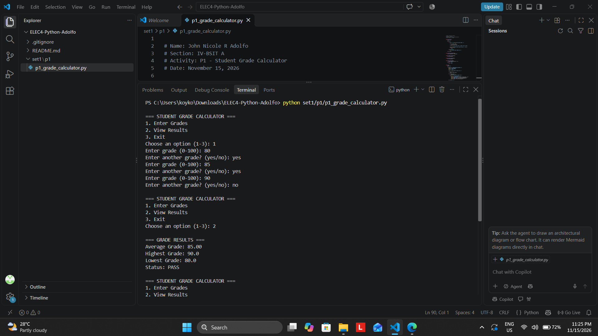
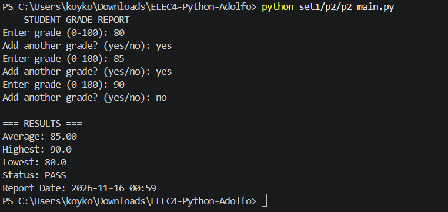
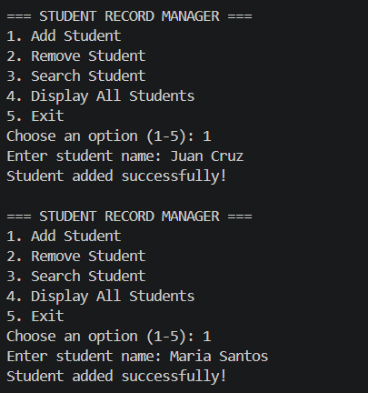
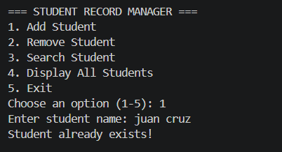
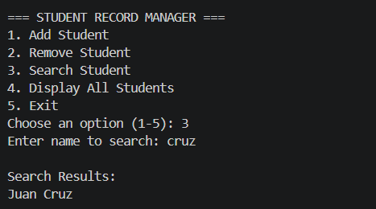
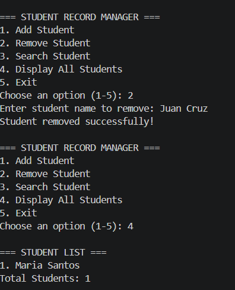
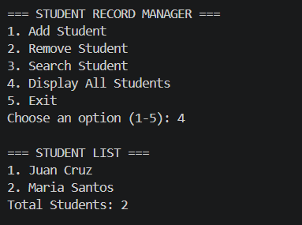
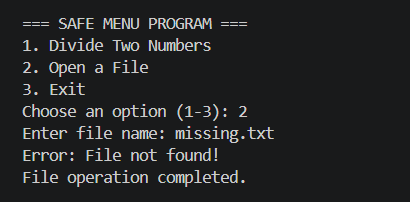
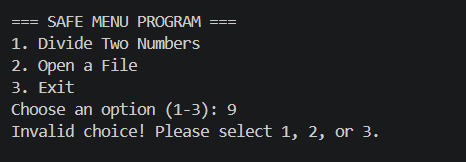

# ELEC 4 - Python Programming

**Name:** John Nicole R Adolfo  
**Section:** IV-BSIT A  
**Course:** ELEC 4 - Python Programming

## Set 1 Activities

### P1 - Student Grade Calculator
A Python program that calculates the average, highest, lowest, and pass/fail status of student grades.

**Activity Folder:** [P1](set1/p1/)

**How to Run:**
```bash
python set1/p1/p1_grade_calculator.py
```

**Sample Output:**




### P2 - Custom Module: student_utils

A Python program that uses a custom module to calculate student grades and display a report with the date and time.

**Activity Folder:** [P2](set1/p2/)

**How to Run:**

```bash
python set1/p2/p2_main.py
```

**Sample Output:**




### P3 - Student Record Manager

A Python program that manages student names using lists and sets. It allows users to add, remove, search, and display students while preventing duplicate entries.

**Activity Folder:** [P3](set1/p3/)

**How to Run:**

```bash
python set1/p3/p3_record_manager.py
```

**Sample Outputs:**












### P4 - Safe Menu Program

A Python menu-driven program that demonstrates exception handling using try, except, else, and finally. It handles invalid numeric input, division by zero, missing files, and invalid menu choices without crashing.

**Activity Folder:** [P4](set1/p4/)

**How to Run:**

```bash
python set1/p4/p4_exceptions.py
```

**Sample Outputs:**





